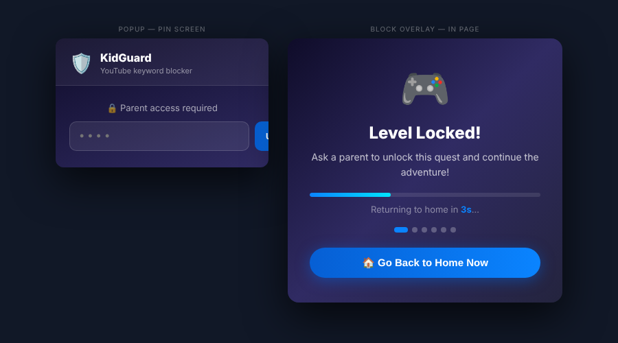

# 🛡️ YT KidGuard

A Chrome extension that **strictly blocks YouTube content** containing specific keywords — built for parents who want a safe viewing experience for their kids.



---

## ✨ Features

- 🔍 **Keyword blocking** — blocks search results, video titles, and recommendation cards matching any blocked keyword
- 🎬 **Strict video kill** — immediately pauses, mutes, and wipes video src so nothing plays in the background
- 🚫 **Full-screen overlay** — shows a friendly kids-style message with a 5-second countdown before auto-redirecting to YouTube home
- 🔄 **12 rotating messages** — each block shows a different fun message (Level Locked!, Mission Denied!, Teamwork Time!, etc.)
- 🔐 **PIN-protected settings** — parents unlock the popup with a PIN (default: `1234`) to manage the keyword list
- 💾 **Persistent keywords** — keyword list is saved via `chrome.storage.sync` and synced across devices
- ⚡ **SPA-aware** — detects YouTube's navigation without full page reloads using MutationObserver

---

## 🚀 Installation

> Chrome Web Store listing coming soon. Install manually for now:

1. Download or clone this repository
2. Open Chrome and go to `chrome://extensions`
3. Enable **Developer mode** (top-right toggle)
4. Click **Load unpacked**
5. Select the folder containing these 4 files

---

## 📁 File Structure

```
yt-kidguard/
├── manifest.json    — Chrome extension config (Manifest V3)
├── content.js       — Main blocking logic (injected into YouTube)
├── popup.html       — Extension popup UI
└── popup.js         — Popup logic (PIN auth + keyword management)
```

---

## 🔒 Default Blocked Keywords

```
roblox, minecraft, gaming, fortnite, maizen,
angelazz brookhaven, angelazz, sniper, rivals,
peppa pig, robux, noobs, sprunki
```

Parents can add or remove keywords anytime via the popup (PIN required).

---

## 🔧 Changing the PIN

Open `popup.js` and update this line at the top:

```js
const SECRET_PIN = "1234";  // ← change to your own PIN
```

---

## 🧠 How It Works

1. **Content script** (`content.js`) runs on every YouTube page
2. A **MutationObserver** watches for SPA navigation (URL changes without full reload)
3. On a **search page** — if the query matches a blocked keyword → overlay shown
4. On a **watch page** — polls the video title up to 6 seconds; if it matches → video killed + overlay shown
5. On **all pages** — recommendation cards matching any keyword are hidden
6. The **overlay** shows a rotating friendly message, a countdown bar, and a "Go Home" button

---

## 👨‍👩‍👦 Built For

Sarvesh — enjoy your screen time safely! 🎮

---

## 📄 License

MIT — free to use and modify.
